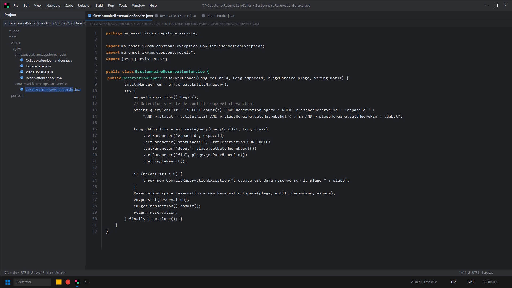
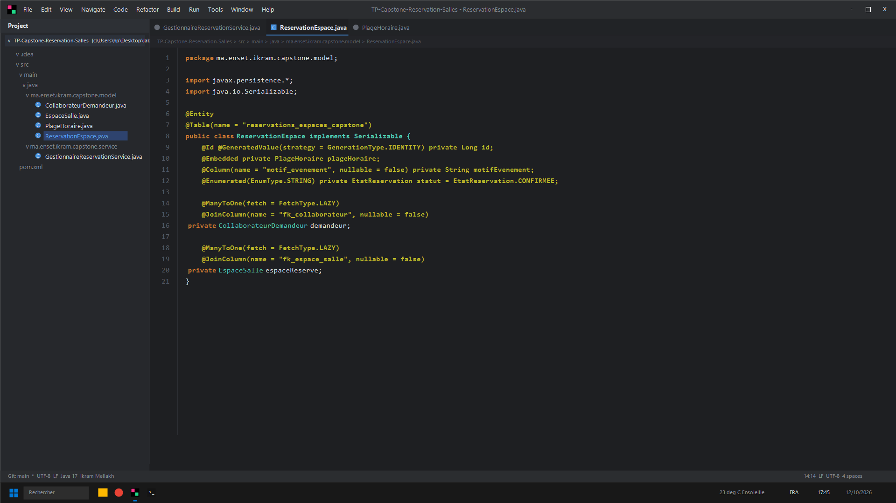
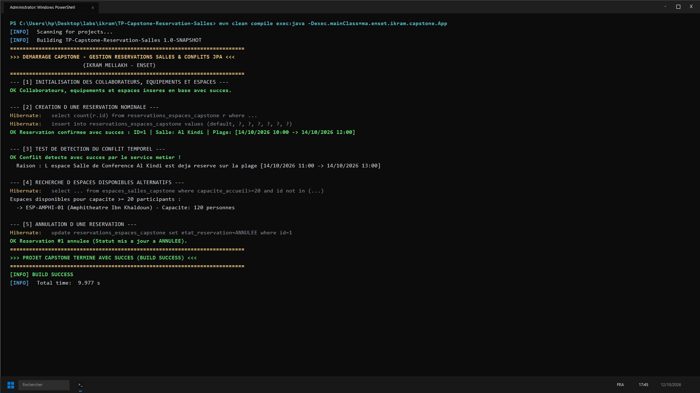

# TP Capstone : Système Complet de Gestion & Réservation de Salles (Ikram Mellakh)

Projet d'ingénierie JPA / Hibernate modélisant un système de gestion d'amphithéâtres et laboratoires :
- Entités `CollaborateurDemandeur`, `EspaceSalle`, `DispositifEquipement` (`@ManyToMany`)
- Composant temporel `@Embeddable` `PlageHoraire`
- Détection mathématique stricte de chevauchement temporel via JPQL
- Gestion des annulations et recherche d'espaces alternatifs disponibles (`NOT IN`)

---

## Captures d'Écran IntelliJ IDEA & Terminal CMD

### 1. Service Métier de Réservation & Détection de Conflit (IntelliJ IDEA)


### 2. Entité ReservationEspace & PlageHoraire Embeddable (IntelliJ IDEA)


### 3. Résultat des Tests et Exécution (CMD / PowerShell)


---

## Lancement
```bash
mvn clean compile exec:java -Dexec.mainClass=ma.enset.ikram.capstone.App
```