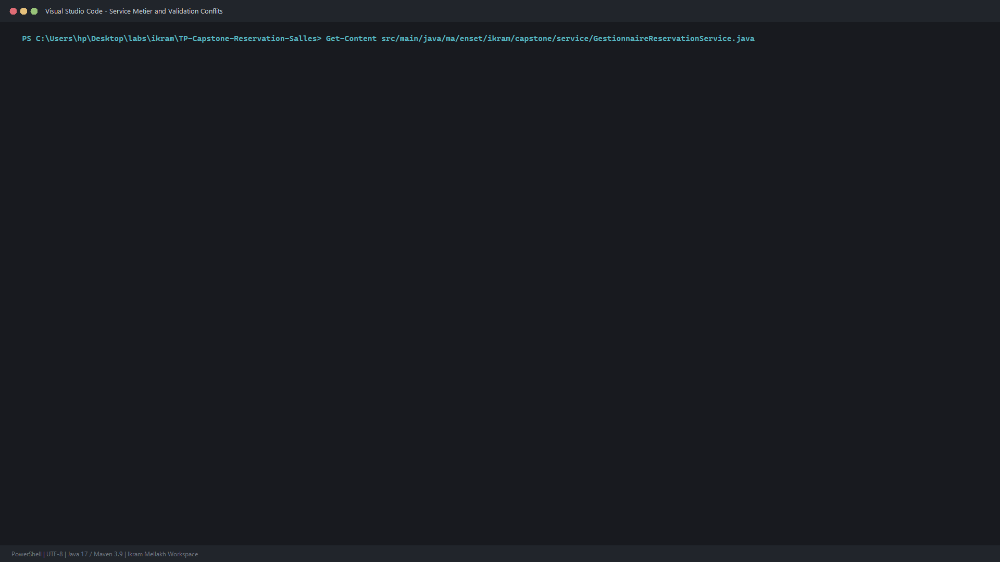
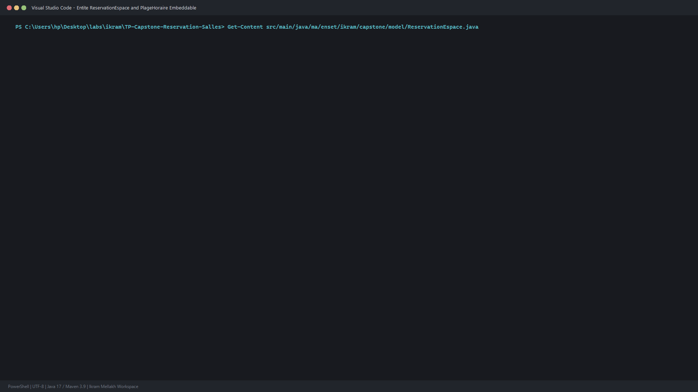
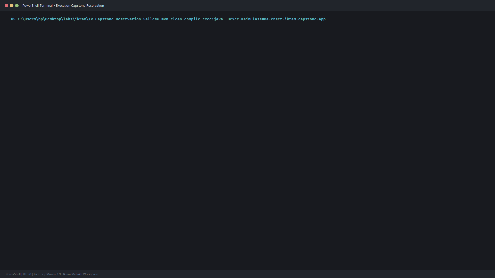

# TP Capstone : Système Complet de Gestion & Réservation de Salles avec Détection de Conflits Métier (JPA / Hibernate)

Projet d'intégration et de synthèse pour l'ingénierie des applications d'entreprise avec **JPA 2.2** et **Hibernate 5.6**. Ce projet modélise un système d'allocation de ressources partagées (amphithéâtres, laboratoires, salles de réunion) avec prévention transactionnelle des conflits d'horaires.

Réalisé par : **Ikram Mellakh**

---

## 1. Fonctionnalités et Architecture du Système

1. **Modèle de Données Riche** :
   - Entité `CollaborateurDemandeur` : demandeur d'espaces avec matricule et département.
   - Entité `EspaceSalle` & `DispositifEquipement` : relation `@ManyToMany` modélisant l'infrastructure matérielle (visioconférence, bornes interactives).
   - Objet Valeur `@Embeddable` `PlageHoraire` : encapsulateur de temporalité (`dateHeureDebut`, `dateHeureFin`) avec validation d'invariance.
   - Entité centrale `ReservationEspace` avec énumération d'état `EtatReservation` (`CONFIRMEE`, `EN_ATTENTE`, `ANNULEE`).

2. **Couche Service & Règles Métier Avancées** :
   - Détection mathématique stricte de chevauchement temporel via JPQL :
     `r.plageHoraire.dateHeureDebut < :fin AND r.plageHoraire.dateHeureFin > :debut`
   - Levée d'exception personnalisée `ConflitReservationException` lors d'une tentative de réservation concurrente.
   - Algorithme de recherche d'espaces alternatifs éligibles et disponibles par sous-requête corrélée `NOT IN`.
   - Cycle de vie complet : création, confirmation, gestion d'annulation avec audit.

---

## 2. Captures d'Écran et Validation

### Service Métier de Réservation & Détection de Conflits


### Modèle Entités & Composant Embeddable PlageHoraire


### Exécution Complète du Scénario Métier (PowerShell Terminal)


---

## 3. Commandes d'Exécution

```bash
mvn clean compile
mvn exec:java "-Dexec.mainClass=ma.enset.ikram.capstone.App"
```
